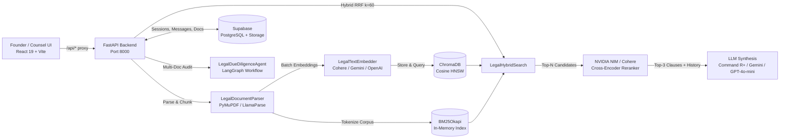

<div align="center">
  <h1>LumièreAI India 🇮🇳</h1>
  <p><b>AI Due Diligence Copilot for Indian Startups, Founders, and Corporate Counsel</b></p>

  [](https://www.python.org/downloads/)
  [](https://fastapi.tiangolo.com/)
  [](https://react.dev/)
  [](https://vitejs.dev/)
  [](https://tailwindcss.com/)
  [](https://supabase.com/)
  [](https://opensource.org/licenses/Apache-2.0)
</div>

<br />

**LumièreAI India** is a full-stack, Retrieval-Augmented Generation (RAG) legal due diligence platform built for the Indian startup and venture ecosystem. It ingests transactional agreements (Term Sheets, Shareholders' Agreements, SAFEs, Pro Rata Side Letters, Mutual NDAs, and KMP Employment Contracts), runs a **Hybrid Search + Cross-Encoder Reranking** pipeline (BM25 + ChromaDB Cosine RRF + NVIDIA NIM / Cohere Rerank), synthesizes grounded legal answers with conversational memory, persists sessions and document metadata in **Supabase**, and performs automated multi-document risk and contradiction audits aligned with Indian corporate law.

---

## ✨ Key Capabilities

- **Conversational AI Due Diligence Copilot (`Home`)**
  - Interactive chat interface integrated directly with `POST /api/query`, maintaining multi-turn context (`chat_messages`) and persistent session history (`chat_sessions`) in Supabase.
  - Displays pipeline execution telemetry pills on every answer (e.g., `BM25 + Chroma Cosine RRF`, `NVIDIA NIM Rerank`, `Cohere Command R+ synthesis`).
  - Supports drag-and-drop PDF upload (`POST /api/upload`) with automatic PyMuPDF extraction, sliding-window chunking, vector indexing in ChromaDB, BM25 re-fitting, and Supabase Storage archiving.
- **Hybrid RAG & Reranking Engine (`src/search.py`)**
  - Combines lexical precision (**BM25Okapi**) with dense semantic retrieval (**ChromaDB** / **FAISS**) via **Reciprocal Rank Fusion (RRF, $k=60$)**.
  - Prioritizes **NVIDIA NIM Rerank (`nvidia/reranking-nv-embed-qa-4`)** with automatic fallback to **Cohere Rerank (`rerank-english-v3.0`)**.
- **Supabase Deal Room Vault (`Documents`)**
  - Searchable, filterable repository across `SHA`, `NDA`, `Employment`, `Term Sheet`, and `SAFE` categories with cloud sync status and one-click audited document export.
- **Multi-Document Live Risk Analysis (`Analysis`)**
  - Audits every uploaded agreement simultaneously with clause-level severity tagging (`HIGH`, `MEDIUM`, `COMPLIANT`), sticky quick-jump navigation, and cross-document conflict highlighting (e.g., SHA Clause 14.1 vs. NDA Clause 6 IP contradiction).
- **Executive Compliance Reports (`Reports`)**
  - Generates a quantified **Deal Health Score**, clause breakdown, and a **Statutory Indian Law Compliance Matrix** covering:
    - *Companies Act, 2013* (Sections 62 & 186)
    - *Indian Contract Act, 1872* (Section 27 restraint of trade)
    - *SEBI (AIF) Regulations, 2012*
    - *Arbitration and Conciliation Act, 1996*
    - *FEMA / RBI Regulations* (Form FC-GPR / FC-TRS)
  - Downloadable plain-text Executive Audit Report for legal counsel and investment committees.

---

## 🏗️ System Architecture



For full architectural diagrams and stage specifications, see [docs/architecture.md](docs/architecture.md).

---

## 📁 Repository Structure

```text
Lumiere-AI/
├── data/
│   ├── raw/                        # Raw PDF agreements for ingestion
│   └── processed/                  # Extracted & chunked JSON files for BM25 fitting
├── docs/                           # Project Engineering & Product Reports
│   ├── docs.md                     # Master technical & user documentation
│   ├── prd.md                      # Product Requirements Document
│   ├── srs.md                      # Software Requirements Specification (IEEE 830)
│   ├── problem.md                  # Problem statement & Indian legal domain analysis
│   ├── architecture.md             # System & 3-stage RAG architecture specification
│   ├── techstack.md                # Full-stack technology inventory & rationale
│   └── sources.md                  # Indian startup legal sources & MCA/FEMA guide
├── frontend/                       # React 19 + Vite 8 + Tailwind CSS v4 Dashboard
│   ├── src/
│   │   ├── components/
│   │   │   ├── Sidebar.jsx         # Navigation rail + Supabase Chat History drawer
│   │   │   ├── Hero.jsx            # AI Copilot chatbox, drag-drop upload & quick actions
│   │   │   ├── DocumentsView.jsx   # Supabase Deal Room vault & export
│   │   │   ├── RiskDemo.jsx        # Multi-document risk & contradiction inspector
│   │   │   ├── ReportsView.jsx     # Executive scorecard & Indian statutory matrix
│   │   │   ├── Features.jsx        # Core platform capabilities
│   │   │   ├── Pricing.jsx         # SaaS & enterprise pricing tiers
│   │   │   ├── TechStack.jsx       # Infrastructure overview cards
│   │   │   ├── Roadmap.jsx         # 3-stage RAG evolution explorer
│   │   │   └── CTA.jsx             # Call-to-action footer banner
│   │   ├── App.jsx                 # Application state & FastAPI/Supabase integration
│   │   └── index.css               # Tailwind v4 @theme design system tokens
│   ├── vite.config.js              # Dev server & /api -> 127.0.0.1:8000 proxy
│   └── package.json
├── notebooks/                      # Progressive 3-Stage RAG Learning Notebooks
│   ├── stage1_basic_rag.ipynb      # Stage 1: PyMuPDF + Dense Vector Search (ChromaDB)
│   ├── stage2_hybrid_search.ipynb  # Stage 2: BM25 + RRF + Reranking
│   └── stage3_advanced_rag.ipynb   # Stage 3: Neo4j Graph RAG + LangGraph + RAGAS
├── src/                            # FastAPI Python Backend
│   ├── __init__.py
│   ├── main.py                     # FastAPI server, RAG orchestration, Supabase sync
│   ├── parser.py                   # PDF text cleaning & sliding-window chunking
│   ├── embedder.py                 # Multi-provider embeddings (Cohere/Gemini/OpenAI)
│   ├── vector_db.py                # ChromaDB persistent store & FAISS support
│   ├── search.py                   # BM25, RRF fusion, NVIDIA NIM & Cohere reranking
│   └── agent.py                    # Multi-document audit & contradiction engine
├── .env.example                    # Sanitized environment variable template
├── .gitignore                      # Excludes .env, .venv, chroma_db, raw/processed data
├── requirements.txt                # Python backend dependencies
├── test_parser.py                  # Batch CLI script to parse data/raw/*.pdf
└── run.bat                         # Windows multi-window launcher (Frontend + FastAPI + Jupyter)
```

---

## ⚙️ Quick Start Setup

### Prerequisites
- **Python**: 3.10+ (tested on 3.11 and 3.14)
- **Node.js**: 18+ (npm 9+)
- **API Keys**: At least one embedding/LLM provider (`COHERE_API_KEY`, `GEMINI_API_KEY`, or `OPENAI_API_KEY`), optionally `NVIDIA_API_KEY` for NIM reranking, and a **Supabase** project for persistence.

### 1. Clone & Configure Environment

```bash
git clone https://github.com/gursimarsingh69/Lumiere-AI.git
cd Lumiere-AI
cp .env.example .env
```

Edit `.env` and set your keys (`SUPABASE_URL`, `SUPABASE_KEY`, `COHERE_API_KEY`, `NVIDIA_API_KEY`, `GEMINI_API_KEY`, `EMBEDDING_PROVIDER=cohere`).

### 2. Provision Supabase Tables & Storage

Run the following SQL in your Supabase **SQL Editor** to create the persistence schema:

```sql
CREATE TABLE IF NOT EXISTS chat_sessions (
  id uuid PRIMARY KEY DEFAULT gen_random_uuid(),
  title text NOT NULL,
  created_at timestamptz DEFAULT now()
);

CREATE TABLE IF NOT EXISTS chat_messages (
  id uuid PRIMARY KEY DEFAULT gen_random_uuid(),
  session_id uuid REFERENCES chat_sessions(id) ON DELETE CASCADE,
  role text NOT NULL,
  content text NOT NULL,
  steps text DEFAULT '[]',
  created_at timestamptz DEFAULT now()
);

CREATE TABLE IF NOT EXISTS documents (
  id uuid PRIMARY KEY DEFAULT gen_random_uuid(),
  name text NOT NULL,
  storage_path text,
  url text,
  compliance_score float,
  created_at timestamptz DEFAULT now()
);
```

Create a Storage bucket named **`documents`** in Supabase Storage.

### 3. Install & Start Backend (FastAPI)

```bash
python -m venv .venv
# Windows:
.venv\Scripts\activate
# macOS/Linux:
source .venv/bin/activate

pip install -r requirements.txt

# Optional: Pre-parse PDFs in data/raw/ and populate ChromaDB
python test_parser.py
python -m src.embedder

# Start FastAPI server on http://localhost:8000
python -m src.main
```

### 4. Install & Start Frontend (React + Vite)

```bash
cd frontend
npm install
npm run dev
```

Open **[http://localhost:5173](http://localhost:5173)** in your browser. All `/api/*` calls automatically proxy to `http://127.0.0.1:8000`.

> **Windows One-Click Launch:** Run `run.bat` from the repository root to launch the React frontend, Jupyter Notebook server, and FastAPI backend simultaneously.

---

## 🔌 Backend REST API Reference

| Method | Endpoint | Description |
| :--- | :--- | :--- |
| `POST` | `/api/query` | Executes Hybrid RAG (BM25 + Chroma RRF + Rerank + LLM synthesis) with session memory and saves messages to Supabase. |
| `GET` | `/api/sessions` | Lists all chat sessions ordered newest-first from Supabase `chat_sessions`. |
| `POST` | `/api/sessions` | Creates a new chat session in Supabase. |
| `GET` | `/api/sessions/{session_id}` | Retrieves chronological messages and trace pills from `chat_messages`. |
| `DELETE` | `/api/sessions/{session_id}` | Deletes a chat session and its messages. |
| `POST` | `/api/upload` | Uploads PDF to Supabase Storage, parses via PyMuPDF, embeds into ChromaDB, and refits BM25. |
| `GET` | `/api/documents` | Lists synced documents from Supabase `documents` table. |
| `POST` | `/api/audit` | Runs `LegalDueDiligenceAgent` across deal-room PDFs and returns compliance score, missing clauses, and contradictions. |

---

## 📚 Project Documentation & Reports

Comprehensive engineering, product, and domain reports are available under [`docs/`](docs/):

| Report | File | Scope |
| :--- | :--- | :--- |
| **Master Documentation** | [docs/docs.md](docs/docs.md) | End-to-end user guide, developer setup, API contracts, module walkthroughs |
| **Product Requirements (PRD)** | [docs/prd.md](docs/prd.md) | Vision, personas, user stories, feature specs, KPIs, pricing & roadmap |
| **Software Requirements (SRS)** | [docs/srs.md](docs/srs.md) | IEEE-830 functional/non-functional specs, interfaces, schema, traceability |
| **Problem Statement** | [docs/problem.md](docs/problem.md) | Indian startup legal friction, statutory landscape, RAG motivation |
| **System Architecture** | [docs/architecture.md](docs/architecture.md) | Full-stack diagrams, Hybrid RRF math, reranking, Graph RAG & agent loops |
| **Technology Stack** | [docs/techstack.md](docs/techstack.md) | Inventory of AI models, vector stores, backend, frontend, and cloud tools |
| **Legal Corpus Guide** | [docs/sources.md](docs/sources.md) | Indian agreements, MCA forms (MGT-7, AOC-4, PAS-3), FEMA & RBI filings |

---

## 🤝 Contributing

Contributions are welcome!
1. Fork the repository
2. Create a feature branch (`git checkout -b feature/your-feature`)
3. Commit your changes (`git commit -m 'Add your feature'`)
4. Push to the branch (`git push origin feature/your-feature`)
5. Open a Pull Request

---

## 📄 License

This project is licensed under the **Apache License 2.0**.
