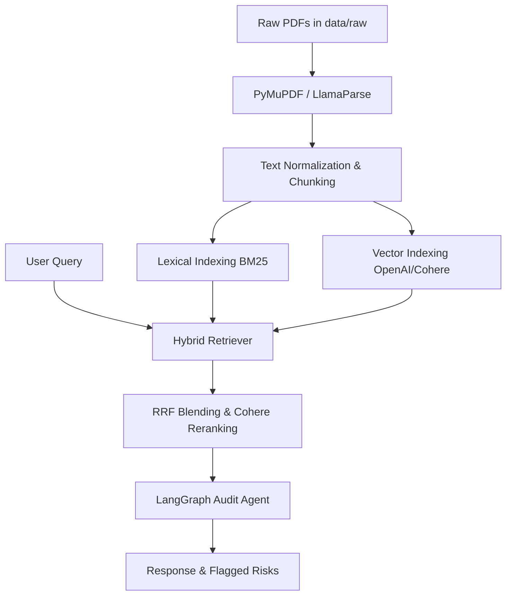

# LumièreAI India — RAG System Architecture

This document outlines the technical design, data flows, and retrieval logic across the three progressive RAG phases.

---

## 🛠️ The RAG Ingestion & Query Pipeline



---

## 🗺️ Stages of Development

### Phase 1: Semantic Retrieval (Basic)
*   **Ingestion**: PyMuPDF splits text by paragraph or arbitrary character tokens (size: 1000 characters, overlap: 200).
*   **Embedding**: Generates vectors using OpenAI's `text-embedding-3-small` (1536 dimensions).
*   **Storage**: ChromaDB Persistent client stored locally under `chroma_db/`.
*   **Query**: Cosine similarity query returns standard matching paragraphs.

### Phase 2: Lexical + Semantic Retrieval (Intermediate)
*   **Hybrid Matching**: A combination of term frequency-inverse document frequency keyword match (BM25) and dense embeddings.
*   **Reciprocal Rank Fusion (RRF)**: Integrates lexical and semantic query orders using the formula:
    $$RRF(d) = \sum_{m \in M} \frac{w_m}{r_m(d) + k}$$
    where $w_m$ is the weight of search type $m$, $r_m(d)$ is the rank of document $d$ in that search type, and $k = 60$.
*   **Reranking**: Sends top 10 RRF candidates to `cohere.Client.rerank` with model `rerank-english-v2.0` to verify semantic relevance, reducing prompt clutter.

### Phase 3: Agentic Graph RAG (Advanced)
*   **Knowledge Graph (Neo4j)**: Maps transactional relationships to represent non-linear clauses:
    ```text
    (:Party) -[:SIGNS {date: '2026-06-12'}]-> (:Agreement)
    (:Agreement) -[:CONTAINS]-> (:Clause {category: 'IP_Assignment'})
    (:Clause) -[:OBLIGATES]-> (:Party)
    (:Clause) -[:CONTRADICTS {reason: 'NDA prior IP conflict'}]-> (:Clause)
    ```
*   **LangGraph Audit Loop**: Executes an agentic state machine for multi-document checking:
    1.  **Ingestion & Parsing State**: Extracted texts mapped to file namespaces.
    2.  **Clause Audit State**: Proactively checks for missing clauses (e.g., audits employment agreement to check if a non-compete is absent).
    3.  **Contradiction State**: Cross-references terms (e.g., checks if the SHA terms violate NDA commitments).
    4.  **Reporting State**: Renders compliance evaluations and logs.
*   **Evaluation (RAGAS)**: Benchmarks output accuracy, checking:
    *   **Faithfulness**: Making sure LLM outputs are sourced strictly from contract chunks.
    *   **Answer Relevance**: Validating output aligns directly to queries.
    *   **Context Recall**: Ensuring all necessary details are fetched.
